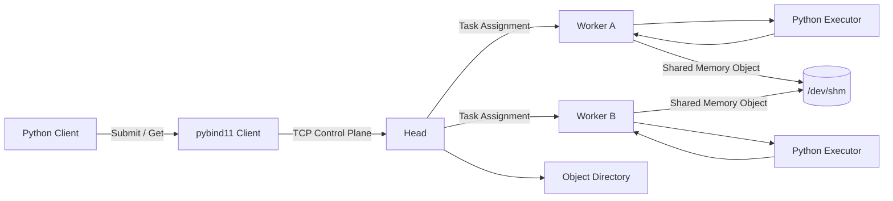

# MiniRay 开发文档

> 状态：立项文档  
> 版本：0.1  
> 更新时间：2026-10-23  
> 目标平台：Linux x86_64，C++20，Python 3.12  
> 当前仓库基线：`main.cpp` 为 Dev Container / 编译器环境自检程序，尚无业务代码

---

## 1. 项目概述

MiniRay 是一个面向学习和小规模部署的分布式任务运行时。它提供类似 Ray 的 Python 使用体验，但控制面、调度器、通信层和对象存储由 C++20 实现。

最小使用方式：

```python
import miniray as ray


@ray.remote(cpu=2, max_retries=2)
def transform(path: str, threshold: float) -> dict:
    # 普通 Python 业务函数
    return {"path": path, "ok": threshold > 0}


refs = [transform.remote(f"part-{i}.bin", 0.8) for i in range(100)]
results = ray.get(refs)
```

调用 `.remote()` 后立即返回 `ObjectRef`，实际任务由 Head 调度到 Worker 执行；`ray.get()` 等待并读取结果。

### 1.1 项目目标

1. 用现代 C++20 实现一个可运行的分布式系统，而不是只做算法练习。
2. 覆盖并发、网络、进程、内存管理、序列化、故障恢复和性能分析。
3. 通过 pybind11 提供稳定的 Python API。
4. 每个里程碑都能独立构建、测试和演示。
5. 先实现可信的单机多进程版本，再扩展到多机部署。

### 1.2 非目标

以下内容不属于 v0.1：

- Kubernetes Operator、Web 管理界面、多租户计费。
- GPU 调度、Actor 模型、流式数据管道。
- 跨语言 SDK（Java、Go、Rust）。
- Head 高可用和分布式共识。
- 完整的 Ray API 兼容。
- 生产级身份认证、TLS 和权限系统。
- 任意 Python 闭包的无条件跨进程序列化。

跨机部署、TLS、Actor 和 GPU 可以在核心路径稳定后单独立项。

---

## 2. 当前基线与约束

### 2.1 已有环境

- `CMakeLists.txt` 使用 C++20，禁用编译器扩展。
- `.devcontainer/devcontainer.json` 直接使用预构建镜像 `cpp-project-dev:2026-10-26-vcpkg-817892b`。
- 镜像内包含 GCC 14、CMake 4.4.3、Ninja、GDB、Python 3.12 和 vcpkg，vcpkg 固定到提交 `817892b0ecbc6af994dd6df999c73faf795adbf2`。
- vcpkg binary cache 使用 Docker volume，避免后续 manifest 依赖重复编译。
- `main.cpp` 检查容器、C++ 标准、vcpkg 环境变量等基础信息。
- 当前目录没有 Git 仓库元数据。

### 2.2 预构建开发镜像

日常打开 Dev Container 时直接复用本地镜像，不在 `postCreateCommand` 中安装工具，启动不再受 apt、vcpkg 和 CMake 下载速度影响。

- 镜像标签：`cpp-project-dev:2026-10-26-vcpkg-817892b`
- Docker Host：WSL2 中 CLion 使用的 Docker daemon，目标架构为 `linux/amd64`
- 项目源码：仍由 Dev Container 挂载到 `/workspaces/cpp-project`
- vcpkg 缓存：volume `cpp-project-vcpkg-binary-cache` 挂载到 `/root/.cache/vcpkg`

需要重建镜像时，在 WSL2 上进入项目目录执行：

```bash
./scripts/build-dev-image.sh
```

脚本会构建并运行基础校验，验证 CMake、GCC、Ninja、Python、vcpkg 和一段 C++20 程序。若生成新标签，需要同步修改 `.devcontainer/devcontainer.json` 的 `image`。如需导出离线归档：

```bash
SAVE_IMAGE=1 ./scripts/build-dev-image.sh
```

归档写入 `dist/`，体积约 2 GB，默认不生成。

### 2.3 工程约束

- 编译标准：C++20，不允许依赖 GNU 扩展。
- 构建系统：CMake + Ninja。
- 依赖管理：vcpkg manifest 模式。
- 支持系统：Linux x86_64 优先；macOS 仅保证单机单元测试可构建。
- Python：3.12，pybind11。
- 所有网络字段明确字节序，不使用主机结构体直接收发。
- 核心 C++ 代码不依赖 Python 头文件；Python 绑定位于独立 target。
- 对外 Python API 使用语义版本控制；内部 C++ API 暂时不承诺 ABI 稳定性。

---

## 3. 术语

| 术语 | 含义 |
|---|---|
| Head | 集群控制面，负责任务登记、调度、状态机和对象目录 |
| Worker | 执行节点，负责注册资源、接收任务、启动执行器并回报结果 |
| Client | 提交任务的进程，通常是 Python 程序 |
| Task | 一次函数调用的逻辑描述，可被重试 |
| Attempt | Task 的一次实际执行，同一个 Task 可以有多个 Attempt |
| ObjectRef | 对不可变对象的全局引用 |
| Object | Task 参数或返回值对应的不可变二进制对象 |
| Lease | Head 授予 Worker 的临时执行权，超时后可重新调度 |
| FunctionRef | 可导入 Python 函数标识，例如 `module:qualname` |

Task 与 Attempt 必须分离。重试不会创建新的 Task，但会创建新的 Attempt，以便审计和去重。

---

## 4. 总体架构



### 4.1 进程职责

#### Head

- 接受 Client 和 Worker 连接。
- 维护 Task、Attempt、ObjectRef 和 Worker 状态。
- 判断依赖是否满足，选择可执行任务。
- 分配资源并下发任务。
- 检测 Worker 心跳、Lease 超时和任务丢失。
- 维护对象引用计数和回收策略。
- 输出结构化日志、指标和审计事件。

#### Worker

- 启动时向 Head 注册资源和执行能力。
- 周期发送心跳。
- 接收任务并在本地执行。
- 将结果封装成 Object。
- 上报开始、成功、失败、进度和日志。
- 在退出时释放租约和本地对象。

#### Python Executor

- 导入 `FunctionRef` 指定的 Python 函数。
- 反序列化参数。
- 执行函数并将异常和结果序列化。
- 不直接参与调度。

### 4.2 控制面与数据面

- **控制面**：可靠 TCP，负责注册、心跳、任务状态和小消息。
- **数据面**：优先使用 POSIX 共享内存，跨机场景退回 TCP 分块传输。
- 控制面消息和数据对象分离，避免大对象阻塞调度消息。

### 4.3 v0.1 部署形态

- 一个 Head。
- 一到四个本地 Worker。
- 一个 Python Client。
- Head 和 Worker 运行在同一个 Linux 主机。
- Worker 通过 Unix domain socket 或 loopback TCP 连接 Head。

---

## 5. 核心模块与目录规划

```text
cpp-project/
├── CMakeLists.txt
├── CMakePresets.json
├── vcpkg.json
├── main.cpp                         # 保留的环境自检入口，最终可迁到 tools/
├── docs/
│   ├── DEVELOPMENT.md
│   ├── protocol.md                  # 后续补充协议细节
│   └── benchmarks.md                # 后续记录压测结果
├── include/miniray/
│   ├── core/
│   │   ├── ids.hpp
│   │   ├── task.hpp
│   │   ├── object_ref.hpp
│   │   └── status.hpp
│   ├── scheduler/
│   │   ├── scheduler.hpp
│   │   └── resource.hpp
│   ├── transport/
│   │   ├── frame.hpp
│   │   ├── connection.hpp
│   │   └── server.hpp
│   ├── store/
│   │   ├── object_store.hpp
│   │   └── shared_memory.hpp
│   └── process/
│       └── child_process.hpp
├── src/
│   ├── core/
│   ├── scheduler/
│   ├── transport/
│   ├── store/
│   ├── process/
│   ├── head/
│   └── worker/
├── python/
│   ├── miniray/
│   │   ├── __init__.py
│   │   ├── client.py
│   │   ├── remote.py
│   │   └── executor.py
│   └── bindings.cpp
├── apps/
│   ├── miniray-head.cpp
│   └── miniray-worker.cpp
├── tests/
│   ├── unit/
│   ├── integration/
│   ├── stress/
│   └── chaos/
├── bench/
└── examples/
```

### 5.1 Target 划分

| CMake target | 类型 | 职责 |
|---|---|---|
| `miniray_core` | static | ID、状态机、Task、ObjectRef |
| `miniray_transport` | static | 帧编解码、连接、事件循环 |
| `miniray_scheduler` | static | 就绪队列、资源匹配、重试 |
| `miniray_store` | static | 共享内存和对象目录 |
| `miniray_head_lib` | static | Head 业务逻辑，便于测试 |
| `miniray_worker_lib` | static | Worker 业务逻辑，便于测试 |
| `miniray-head` | executable | Head 进程入口 |
| `miniray-worker` | executable | Worker 进程入口 |
| `_miniray` | shared module | Python C++ 扩展 |
| `miniray_tests` | executable | 单元与集成测试 |

业务逻辑必须能在不启动真实网络、不 fork 子进程的情况下被单元测试；可执行文件只负责参数解析、装配和事件循环启动。

---

## 6. 核心数据模型

### 6.1 ID

```cpp
struct ObjectId {
    std::array<std::byte, 16> bytes;
};

struct TaskId {
    std::array<std::byte, 16> bytes;
};
```

规则：

- 使用 128 位随机 ID，格式化为小写十六进制或 UUID。
- 不同 ID 类型不能隐式互转。
- 日志中输出完整 ID；展示层可以截断。
- 不用任务计数作为外部 ID，避免重启和重试冲突。

### 6.2 TaskSpec

```cpp
struct TaskSpec {
    std::string function_ref;                  // module:qualname
    std::vector<ObjectId> args;
    std::vector<ObjectId> kwargs;              // v0.1 可通过单个 dict Object 传递
    ResourceRequest resources;
    std::uint32_t max_retries = 0;
    std::chrono::milliseconds timeout{0};      // 0 表示不设置任务级超时
};
```

### 6.3 Task 状态机

```text
PENDING -> READY -> RUNNING -> SUCCEEDED
                     |    |
                     |    +-> FAILED
                     +------> LOST
PENDING/READY/RUNNING -> CANCELLED
FAILED/LOST -> READY            # 仅当还有重试次数
```

约束：

- 状态只能沿合法边迁移。
- 每次迁移记录事件：时间、原因、Actor、Attempt。
- 客户端看到的终态只有 `SUCCEEDED`、`FAILED`、`CANCELLED`。
- `LOST` 是内部状态，进入后根据重试策略转为 `READY` 或 `FAILED`。

### 6.4 Attempt

```cpp
struct Attempt {
    TaskId task_id;
    std::uint32_t attempt_no;
    std::string worker_id;
    std::chrono::steady_clock::time_point lease_deadline;
    AttemptState state;
};
```

同一个 Task 最多只有一个有效 Lease。Lease 超时后旧 Attempt 被视为失效，即使它稍后返回结果也不能覆盖已经成功的新 Attempt。

### 6.5 ObjectRef

```cpp
struct ObjectRef {
    ObjectId id;
    std::uint64_t size;
    ObjectLocation location;
};
```

所有权规则：

- Object 一旦发布即不可变。
- 引用计数的修改由 Object Directory 串行化。
- 任务参数产生的引用在任务终态后释放。
- Worker 崩溃时，其拥有的临时对象标记为不可用，并触发依赖任务失败或重算。

---

## 7. 调度设计

### 7.1 v0.1 策略

1. Head 维护 `PENDING`、`READY`、`RUNNING` 队列。
2. 当 Task 的所有参数 Object 可访问后，将其移入 `READY`。
3. Worker 注册时上报 `cpu_slots`、`memory_bytes` 和标签。
4. 调度器从 READY 队列取任务，按资源需求选择可容纳的 Worker。
5. 默认 FIFO；相同优先级内不允许大任务长期饥饿。
6. 绑定 Worker 后创建 Attempt 和 Lease。
7. Worker 周期续租；完成后回报结果。
8. Lease 超时、Worker 心跳丢失或 Worker 退出时，任务重新排队或失败。

v0.1 不实现复杂的公平调度和抢占。资源不足的 Task 必须留在 READY 队列，不影响其他小任务调度。

### 7.2 重试语义

- 默认 `max_retries = 0`，即失败不重试。
- 重试只针对 `WORKER_LOST`、Lease 超时和显式标记为可重试的基础设施错误。
- Python 用户异常默认不重试，除非调用方显式允许。
- 系统提供 **at-least-once** 执行语义，不承诺 exactly-once。
- 有副作用的函数必须由调用方保证幂等，或将 `max_retries` 设为 0。
- 重复结果只接受与当前有效 Attempt 对应的结果。

### 7.3 取消

- `PENDING`、`READY` 任务可立即取消。
- `RUNNING` 任务先进入取消请求状态，由 Worker 发送停止信号。
- Python 执行器收到 `SIGTERM` 后先尝试正常退出，超时后 `SIGKILL`。
- 被取消任务的输出必须丢弃。

---

## 8. 通信协议

### 8.1 帧格式

所有数值使用网络字节序。固定帧头为 24 字节：

| 字段 | 字节 | 说明 |
|---|---:|---|
| magic | 4 | ASCII `MRP1` |
| version | 2 | 当前为 1 |
| message_type | 2 | 消息类型 |
| flags | 4 | 压缩、加密等标志，v0.1 为 0 |
| request_id | 8 | 请求/响应关联 ID |
| payload_size | 4 | 负载长度，最大 16 MiB |
| payload_crc32c | 4 | 负载校验和 |

控制消息使用 Protobuf 编码；大对象不塞进普通控制帧。

### 8.2 消息集合

| 方向 | 消息 | 用途 |
|---|---|---|
| Client -> Head | `SubmitTask` | 提交任务及参数引用 |
| Client -> Head | `GetObject` | 阻塞或轮询获取结果 |
| Client -> Head | `CancelTask` | 请求取消 |
| Worker -> Head | `RegisterWorker` | 注册资源与能力 |
| Worker -> Head | `Heartbeat` | 上报存活和负载 |
| Head -> Worker | `AssignTask` | 下发任务与 Lease |
| Worker -> Head | `TaskStarted` | 确认开始执行 |
| Worker -> Head | `TaskSucceeded` | 返回结果对象描述 |
| Worker -> Head | `TaskFailed` | 返回结构化错误 |
| Worker -> Head | `ReleaseObject` | 通知本地对象可回收 |
| 双向 | `Ack` / `Error` | 确认和错误响应 |

### 8.3 连接规则

- 单连接上的帧必须串行写入，禁止多线程同时写 socket。
- 读取端必须处理半包、粘包、超大长度和 CRC 错误。
- 连接断开时，所属请求统一完成并返回明确错误。
- 心跳间隔默认 1 秒，连续丢失 3 次判定 Worker 失联。
- 控制协议必须有版本号；不兼容版本直接拒绝并返回可读错误。

---

## 9. 对象存储

### 9.1 分阶段策略

**阶段 A：Head 内存存储**

- 所有结果先上传到 Head。
- 实现简单，用于跑通端到端链路。
- 限制对象大小，例如单对象不超过 64 MiB。

**阶段 B：共享内存**

- 大于 64 KiB 的对象写入 `/dev/shm/miniray/`。
- 小对象内联在控制消息中。
- 用 POSIX 共享内存名或临时文件传递句柄。
- 读写两端使用 `mmap`，消费者只读映射。
- 发布前完成写入，发布后不再修改。

### 9.2 对象生命周期

```text
CREATING -> SEALED -> REFERENCED -> RELEASED
                \-> INVALID
```

- `CREATING`：生产者写入中，不可读。
- `SEALED`：完整写入并校验成功，不可变。
- `REFERENCED`：至少有一个 Task 或 Client 持有引用。
- `RELEASED`：引用归零，可回收。
- `INVALID`：Worker 崩溃或校验失败，不能再读取。

必须处理以下情况：

- 写入一半时 Worker 崩溃。
- 多个任务并发等待同一对象。
- 任务取消后引用归零。
- 客户端断开导致引用泄漏。
- 共享内存文件已存在但内容不完整。

v0.1 可以增加基于启动时间的命名空间和启动清理，但仍要提供显式回收测试。

---

## 10. Python API

### 10.1 公共 API

```python
import miniray as ray

ray.init(address="127.0.0.1:6380")
ray.shutdown()

@ray.remote(cpu=1, memory="512MiB", max_retries=2, timeout="30s")
def f(x: int) -> int:
    return x * 2

ref = f.remote(21)
assert ray.get(ref) == 42
```

### 10.2 约束

- `@remote` 只支持模块顶层函数。
- 函数必须能通过 `module:qualname` 在 Worker 中导入。
- 参数和返回值必须可被 `pickle` 序列化。
- 闭包、lambda 和交互式定义的函数不属于 v0.1 支持范围。
- NumPy 数组后续通过 `__reduce__` 或共享内存协议优化；v0.1 允许多一次复制。
- `ray.get()` 必须正确处理超时、连接断开、任务失败和取消。

### 10.3 pybind11 边界

C++ 扩展只暴露低层能力：

```cpp
py::class_<Client>(m, "Client")
    .def("submit", &Client::submit)
    .def("get", &Client::get)
    .def("cancel", &Client::cancel);
```

Python 层负责装饰器、函数元数据、pickle 和异常映射。这样可以降低 C++ 绑定层的复杂度。

所有可能阻塞的 C++ 调用必须释放 GIL：

```cpp
py::gil_scoped_release release;
auto result = client_->get(id, timeout);
```

---

## 11. 并发模型

### 11.1 Head

- 一个 I/O 线程负责 socket 事件。
- 一个调度线程负责状态推进和资源匹配。
- 每个连接由一个串行执行队列处理，避免消息乱序。
- 共享状态优先由单线程拥有；必须共享时使用明确锁范围。
- 禁止在持有调度器锁时执行文件 I/O、日志磁盘同步或网络阻塞写。

### 11.2 Worker

- 一个控制连接线程。
- 一个心跳线程或定时器任务。
- 固定数量的执行槽位。
- 每个 Python Executor 对应一个子进程。
- 负责回收子进程和清理临时对象。

### 11.3 线程与资源规则

- 不在线程池任务中阻塞等待另一个固定线程池任务，避免线程池饥饿。
- 所有 `std::thread` 和 `std::jthread` 都必须有明确停止路径。
- 析构函数不能隐式阻塞不确定时长。
- 共享状态用 `std::mutex` 或 `std::shared_mutex`，不要先引入无锁结构。
- 无锁队列只允许在压测证明需要后实现，并且必须有 TSan 测试。

---

## 12. 错误模型与故障恢复

### 12.1 统一错误结构

```cpp
struct Error {
    ErrorCode code;
    std::string message;
    bool retryable;
    std::string details;
};
```

错误码至少包括：

- `INVALID_ARGUMENT`
- `NOT_FOUND`
- `RESOURCE_EXHAUSTED`
- `TIMEOUT`
- `WORKER_LOST`
- `OBJECT_UNAVAILABLE`
- `SERIALIZATION_ERROR`
- `EXECUTION_ERROR`
- `CANCELLED`
- `PROTOCOL_ERROR`
- `INTERNAL`

### 12.2 故障矩阵

| 故障 | 期望行为 |
|---|---|
| Worker 心跳超时 | Lease 失效，任务重排或失败 |
| Worker 执行中崩溃 | 清理 Attempt，按重试策略重新调度 |
| Worker 返回重复结果 | 旧 Attempt 结果被忽略 |
| Head 无法连接 | Client 返回明确网络错误，不无限挂起 |
| Python 函数抛异常 | 保留 traceback 摘要，任务进入 FAILED |
| 对象校验失败 | 对象标记 INVALID，任务失败 |
| Client 断开 | 已提交任务默认继续执行并保留结果 |
| 任务取消与成功竞争 | 以 Head 串行状态迁移为准，只接受一个终态 |
| 共享内存残留 | 启动时按命名空间清理，并提供显式清理命令 |

### 12.3 超时层次

- 连接超时。
- 单次 RPC 超时。
- Lease 续租超时。
- 任务执行超时。
- Client `get()` 超时。

不同超时必须有独立配置项，不能共用一个全局超时值。

---

## 13. 可观测性

### 13.1 日志

使用结构化日志，字段至少包含：

- 时间
- 级别
- 组件
- `task_id`
- `attempt_no`
- `worker_id`
- `object_id`
- 事件名
- 耗时
- 错误码

日志默认输出到 stderr，不依赖外部日志服务。

### 13.2 指标

v0.1 至少提供：

- `miniray_tasks_submitted_total`
- `miniray_tasks_succeeded_total`
- `miniray_tasks_failed_total`
- `miniray_tasks_retried_total`
- `miniray_tasks_running`
- `miniray_ready_queue_depth`
- `miniray_workers_alive`
- `miniray_scheduling_latency_ms`
- `miniray_task_duration_ms`
- `miniray_object_bytes`
- `miniray_shm_bytes`

指标先通过本地文本端点或定期日志输出，不强制接入 Prometheus。

### 13.3 追踪

为每个 Task 生成 trace 上下文。至少记录：

```text
submit -> queued -> assigned -> started -> finished -> object_sealed -> client_get
```

---

## 14. 开发里程碑

### M0：工程骨架（预计 1-2 天）

范围：

- 增加 `vcpkg.json` 和 `vcpkg-configuration.json`。
- 增加 `CMakePresets.json`。
- 将现有自检程序保留为 `tools/env_check.cpp` 或继续作为独立 target。
- 引入 Catch2。
- 建立 `miniray_core` 与测试 target。
- 增加格式化、静态检查和 sanitizer preset。

验收：

- Debug、Release、ASan、TSan 配置都能完成一次构建。
- `ctest` 可以运行至少一个测试。
- 不修改现有 `.devcontainer` 的工作目录约定。

### M1：单进程任务状态机（预计 3-5 天）

范围：

- `TaskId`、`ObjectId`、`TaskSpec`、`ObjectRef`。
- Task 状态机和非法迁移检查。
- 固定大小线程池。
- 内存版就绪队列和依赖图。
- Future/Result 基础机制。
- 取消与超时基础结构。

验收：

- 单元测试覆盖所有合法和非法状态迁移。
- DAG 中任务按依赖顺序执行。
- 取消不会导致永久阻塞。
- ASan/TSan 测试通过。

### M2：Head/Worker 控制面（预计 5-8 天）

范围：

- 帧协议和 Protobuf 消息。
- Head 接受 Worker 注册、心跳和任务回报。
- Worker 注册资源并执行 C++ 测试任务。
- Lease、心跳超时、任务重新调度。
- 简单 CLI 参数。

验收：

- 一个 Head + 两个 Worker 完成 1,000 个测试任务。
- `kill -9` Worker 后任务能按策略重试。
- 半包、粘包、CRC 错误都有测试。
- 10 次重复集成测试无偶发失败。

### M3：Python 接口与执行器（预计 5-8 天）

范围：

- `_miniray` pybind11 扩展。
- `@remote`、`.remote()`、`ray.get()`、`ray.cancel()`。
- 顶层 Python 函数导入。
- pickle 参数和返回值。
- Python 异常到结构化错误映射。
- 阻塞调用释放 GIL。

验收：

- 示例程序能跨进程执行 Python 函数。
- 异常 traceback 能返回客户端。
- 并发 100 个 Python 任务不出现 GIL 死锁。
- Client 连接断开、超时和取消有明确错误。

### M4：共享内存对象存储（预计 5-8 天）

范围：

- 小对象内联。
- 大对象写入 `/dev/shm`。
- `mmap` 只读消费。
- 对象引用计数和释放。
- Worker 异常退出后的清理。
- 对象校验失败处理。

验收：

- 128 MiB 传输不经过完整 TCP 复制。
- 多消费者读取同一对象成功。
- 引用归零后共享内存文件被删除。
- Worker 崩溃不留下无法识别或覆盖的错误对象。

### M5：可靠性与可观测性（预计 4-6 天）

范围：

- 完整故障矩阵。
- 指标和结构化日志。
- 自动化 chaos test。
- 任务审计事件查询。
- 优雅停机。

验收：

- 随机杀 Worker、随机取消、随机断连测试通过。
- 不出现重复终态、悬挂任务或永久资源泄漏。
- 日志能够追溯一次任务从提交到完成的全过程。

### M6：性能与发布（预计 3-5 天）

范围：

- 微基准：帧编解码、队列、对象复制。
- 系统基准：任务吞吐、调度延迟、对象大小曲线。
- 发布包和安装说明。
- v0.1 使用手册。

验收：

- 在固定硬件和固定配置下生成可复现的 `docs/benchmarks.md`。
- Release 构建无 ASan/UBSan 报告。
- 示例、配置、协议和限制均有文档。
- 明确记录尚未解决的问题，不把未验证能力写成已完成。

---

## 15. 测试策略

### 15.1 单元测试

- ID 编解码。
- 帧头和半包解析。
- 状态迁移。
- 资源匹配。
- Lease 超时计算。
- 对象引用计数。
- Python 参数序列化辅助函数。

### 15.2 集成测试

- Head + Worker 生命周期。
- 提交、执行、获取结果。
- Worker 注册、心跳和退出。
- Client 超时和断连。
- 多 Worker 并发执行。
- 取消与成功竞争。

### 15.3 压力测试

- 100,000 个空任务提交。
- 1,000 个带依赖的任务。
- 100 个并发 Client。
- 1 KiB、1 MiB、128 MiB 三种对象。
- 4 个 Worker 同时执行和退出。

### 15.4 Chaos 测试

- 随机 `SIGKILL` Worker。
- 随机关闭 Client socket。
- 延迟、丢失或重复控制消息。
- 写入共享内存中途杀进程。
- Head 停止接受新连接。
- Worker 反复注册和断开。

### 15.5 测试门禁

每次合并必须满足：

- Debug 测试全通过。
- ASan + UBSan 测试全通过。
- TSan 至少覆盖调度器和连接管理测试。
- 新增故障路径必须有对应测试或明确记录为未覆盖。
- 不允许靠重复执行掩盖偶发失败。

---

## 16. 性能与资源目标

首版目标是建立可测量基线，而不是追求 Ray 的绝对性能。

建议基准硬件：

- 4 vCPU。
- 8 GiB 内存。
- Linux x86_64。
- 本地 SSD。
- 1 个 Head + 4 个 Worker。

需要记录：

- 提交吞吐（tasks/s）。
- 端到端延迟 P50/P95/P99。
- 调度延迟。
- 空任务、1 KiB、1 MiB、128 MiB 对象吞吐。
- 不同 Worker 数量下的变化。
- 每次测试的 commit、编译器和构建类型。

初始工程目标：

- 1,000 个空任务在 4 个 Worker 上完成，无任务丢失。
- 100 MiB 对象通过共享内存传输时，RSS 不因整块复制而线性翻倍。
- 调度器在 10,000 个等待任务时仍能推进新任务。
- 空闲时 Head 和 Worker 不持续占用明显 CPU。

以上是工程目标，不是已实现结果；最终以 `docs/benchmarks.md` 的实测数据为准。

---

## 17. 安全边界

v0.1 仅适用于可信本地环境。

- 默认只监听 `127.0.0.1`。
- 不执行来自不可信 Client 的任意代码。
- Python 任务等同于在本机执行任意代码，必须明确告知用户。
- 不提供 TLS，不跨公网部署。
- 不记录参数原文中的敏感数据。
- 日志中的对象内容默认不打印。
- 共享内存目录权限限制为当前用户。
- 如果后续开放网络监听，必须先完成认证、TLS、资源限额和审计。

---

## 18. 编码规范

### 18.1 C++

- 使用 C++20。
- 类型和函数使用 `snake_case`，类使用 `PascalCase`。
- 所有权通过 `std::unique_ptr`、`std::shared_ptr` 和值语义表达。
- `std::span` 只表示非拥有视图。
- 禁止裸 `new` / `delete`。
- 禁止无停止条件的 detached thread。
- 不使用异常跨 C ABI/网络边界直接传播。
- 网络字节序在协议编解码层统一处理。
- 头文件必须自包含。
- 公共头文件避免暴露第三方类型。
- 先保证正确性，再通过基准决定是否引入无锁结构。

### 18.2 Python

- 公共 API 使用类型标注。
- 用户可见异常继承 `miniray.MiniRayError`。
- 不在 Python 层重复实现 C++ 状态机。
- `pickle` 边界集中封装，禁止散落在业务代码中。

### 18.3 提交规范

建议使用：

```text
feat: add task state machine
fix: reject oversized protocol frame
test: cover worker lease expiry
perf: avoid object copy in shared memory read
docs: document python executor limits
```

一个提交只解决一个可描述的问题。

---

## 19. 构建与开发命令

M0 完成后应提供以下命令：

```bash
# 配置 Debug
cmake --preset dev

# 构建
cmake --build --preset dev

# 运行测试
ctest --preset dev --output-on-failure

# 配置 ASan/UBSan
cmake --preset asan

# 配置 TSan
cmake --preset tsan
```

推荐 preset：

| Preset | 用途 |
|---|---|
| `dev` | Debug + Ninja + 测试 |
| `release` | RelWithDebInfo |
| `asan` | AddressSanitizer + UndefinedBehaviorSanitizer |
| `tsan` | ThreadSanitizer |
| `coverage` | 单元测试覆盖率 |

预期依赖：

```json
{
  "name": "miniray",
  "version-string": "0.1.0",
  "dependencies": [
    "catch2",
    "protobuf",
    "pybind11"
  ]
}
```

依赖必须锁定版本或 baseline，不使用无锁定的 `latest`。

---

## 20. 配置

配置文件使用 TOML，命令行参数覆盖配置文件。

Head 示例：

```toml
[head]
listen = "127.0.0.1:6380"
max_message_bytes = 16777216
heartbeat_interval_ms = 1000
worker_timeout_ms = 3000
object_dir = "/dev/shm/miniray"

[scheduler]
policy = "fifo"
max_ready_queue = 100000
```

Worker 示例：

```toml
[worker]
head_address = "127.0.0.1:6380"
cpu_slots = 4
memory_bytes = 4294967296
python_executable = "/usr/local/bin/python"
python_path = "."

[executor]
max_tasks = 4
startup_timeout_ms = 10000
shutdown_grace_ms = 3000
```

配置加载顺序：

1. 内置默认值。
2. TOML 文件。
3. 环境变量。
4. 命令行参数。

启动时必须打印生效配置，但敏感字段要脱敏。

---

## 21. Definition of Done

一个功能只有同时满足以下条件才算完成：

- 代码已实现，并通过编译。
- 有覆盖主路径和关键失败路径的测试。
- 不引入新的 Sanitizer 报告。
- 日志和错误信息足够定位问题。
- 公共 API 有文档。
- 协议或状态机变化已更新设计文档。
- 性能影响有数据，或在明确不需要测量的原因。
- 未完成或未验证的内容写入风险清单。

“函数能跑”不等于完成；没有故障路径验证的调度能力不能标记为可靠。

---

## 22. 风险与待决策项

| 风险/问题 | 影响 | 当前决策 |
|---|---|---|
| Python 函数跨进程导入 | 闭包和交互式函数无法直接执行 | v0.1 只支持模块顶层函数 |
| 共享内存生命周期复杂 | 残留、泄漏、崩溃清理困难 | 先实现严格引用计数和启动清理 |
| 重试导致副作用重复 | 用户业务可能重复写数据 | 默认不重试，公开 at-least-once 语义 |
| 自研协议维护成本 | 兼容性和边界测试负担高 | 控制面 Protobuf，传输帧自行实现 |
| 单调度线程可能成为瓶颈 | 高任务量时调度延迟上升 | 先测量；用批处理和索引优化 |
| Python GIL 限制 | 单进程并行度有限 | 多执行器进程隔离 |
| 8 GiB 主机资源有限 | 压测容易受内存和 I/O 干扰 | 固定小规模基准，记录资源曲线 |
| 当前目录不是 Git 仓库 | 无法追踪回滚和提交边界 | 开发前先初始化或明确迁移到目标仓库 |

需要尽早决定的 ADR：

- 是否在 M2 前初始化 Git 仓库。
- 控制面是否直接使用 gRPC，还是保留自定义 TCP 帧。
- 对象目录是放在 Head 还是独立 Object Store 进程。
- Python 执行器是每任务子进程，还是可复用进程池。
- TOML 解析使用哪个 vcpkg 库，还是先采用最小自研解析器。

---

## 23. 第一周执行清单

1. 初始化 Git 仓库，提交当前环境自检基线。
2. 添加 `vcpkg.json`、`CMakePresets.json` 和测试框架。
3. 将现有 `main.cpp` 保留为环境检查 target。
4. 建立 `miniray_core`，先实现 `TaskId`、`ObjectId` 和 Task 状态机。
5. 写状态迁移的完整单元测试。
6. 建立单线程调度器原型，不接网络。
7. 在 `docs/` 记录第一版 ADR：执行语义、Python 函数约束、对象传输方案。
8. 保证 ASan 和 TSan preset 可运行。

第一周不开始写共享内存、Protobuf 协议或复杂调度策略；先把状态机、所有权和测试基础打牢。
